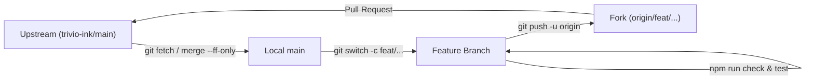

# Contributing to Trivio

Thank you for your interest in contributing to Trivio (`trivio.ink`). We welcome contributions that maintain our high standards of mathematical determinism, type safety, and developer-first design.

---

## 1. Code of Conduct

We are committed to providing a welcoming, inclusive, and harassment-free environment for everyone. Please be respectful, constructive, and collaborative in all discussions and code reviews.

---

## 2. Repository Visibility & Confidentiality Advisory

> [!IMPORTANT]
> **Public Repository Stance:** Both the upstream organization repository (`https://github.com/trivio-ink/trivio-platform`) and developer forks are currently **publicly visible**.
> - Never commit sensitive intellectual property, proprietary rate negotiations, or unannounced commercial agreements.
> - Never commit client data, live transaction records, API tokens, `.env` files, or private keys.
> - Generic SDK libraries must remain neutral and free of proprietary merchant identities.

---

## 3. Official Fork-Development Workflow

Trivio mandates an isolated fork-and-upstream development model. Maintainers and contributors work in personal forks and submit contributions to the organization via Pull Requests.



### The 14-Step Procedure

1. **Fetch Upstream:** Retrieve the latest commits from the canonical organization repository:
   ```bash
   git fetch upstream
   ```
2. **Synchronize Local `main` Safely:** Fast-forward local `main` to align with `upstream/main`:
   ```bash
   git checkout main
   git merge --ff-only upstream/main
   ```
3. **Create a Scoped Feature Branch:** Always branch from synchronized `main`:
   ```bash
   git switch -c feat/my-feature
   ```
4. **Implement Scoped Feature:** Make surgical, focused changes adhering to Trivio architecture.
5. **Execute Local Quality Checks:** Validate compilation, types, and tests:
   ```bash
   npm run check
   ```
6. **Update Documentation:** Keep `README.md`, `AGENTS.md`, and architectural records in sync.
7. **Commit Changes:** Use Conventional Commits with scope prefixes (see below).
8. **Push to Developer Fork:** Never push directly to `upstream/main`:
   ```bash
   git push -u origin feat/my-feature
   ```
9. **Open a Pull Request:** Target `trivio-ink/trivio-platform:main` from your fork branch.
10. **Complete Mandatory PR Documentation:** Fill out all 13 sections of the PR template.
11. **Verify GitHub Actions Execution:** Confirm that both `CI` and `PR Description Validator` pass.
12. **Review Code Changes:** Address review comments, resolving discussions thoughtfully.
13. **Merge After Acceptance:** Merge via Squash or Rebase as approved by the maintainer.
14. **Synchronize Fork Post-Merge:** Pull upstream updates and push them to your fork's `main`.

---

## 4. Conventional Commit Standards

All commits must follow the [Conventional Commits](https://www.conventionalcommits.org/) specification with appropriate workspace scopes:

### Allowed Types
- `feat`: A new user-facing feature or calculation primitive
- `fix`: A bug fix or boundary condition correction
- `docs`: Documentation additions or revisions
- `test`: Adding or correcting automated tests
- `chore`: Tooling, dependency, or workflow maintenance
- `refactor`: Code change that neither fixes a bug nor adds a feature

### Examples with Scopes
- `feat(core): implement configurable MDR rules`
- `fix(core): correct monetary rounding boundary on fractional penny`
- `docs(sdk): add developer integration examples for express`
- `test(core): expand financial precision tests for 10000 bps ceiling`
- `chore(ci): strengthen pull request description validator`
- `chore(governance): enforce development and PR standards`

---

## 5. Architectural & Financial Rules

1. **Deterministic Minor Units:** Never use floating-point math (`0.1 + 0.2`) for financial calculations. Always use integer minor currency units and `BigInt` precision.
2. **Zero-Dependency Core:** `@trivio.ink/core` must not depend on databases, network clients, environment variables, or external runtime dependencies.
3. **No Hardcoded Bank Rates:** Never hardcode regional acquirer fees, merchant discount agreements, or banking credentials into generic libraries.
4. **Developer-Owned Data:** Keep calculation logic decoupled from hosted cloud persistence. Developers own their transaction data.
5. **Private Packages in Stage 1 & 1.1:** Do not publish packages to public npm until officially authorized.

---

## 6. Verification Checklist

Before submitting a Pull Request, verify:

```bash
# 1. Clean installation against lockfile
npm ci

# 2. TypeScript builds compile cleanly
npm run build

# 3. Type checking passes with zero errors
npm run typecheck

# 4. All unit tests pass
npm test

# 5. Master validation command passes
npm run check
```
