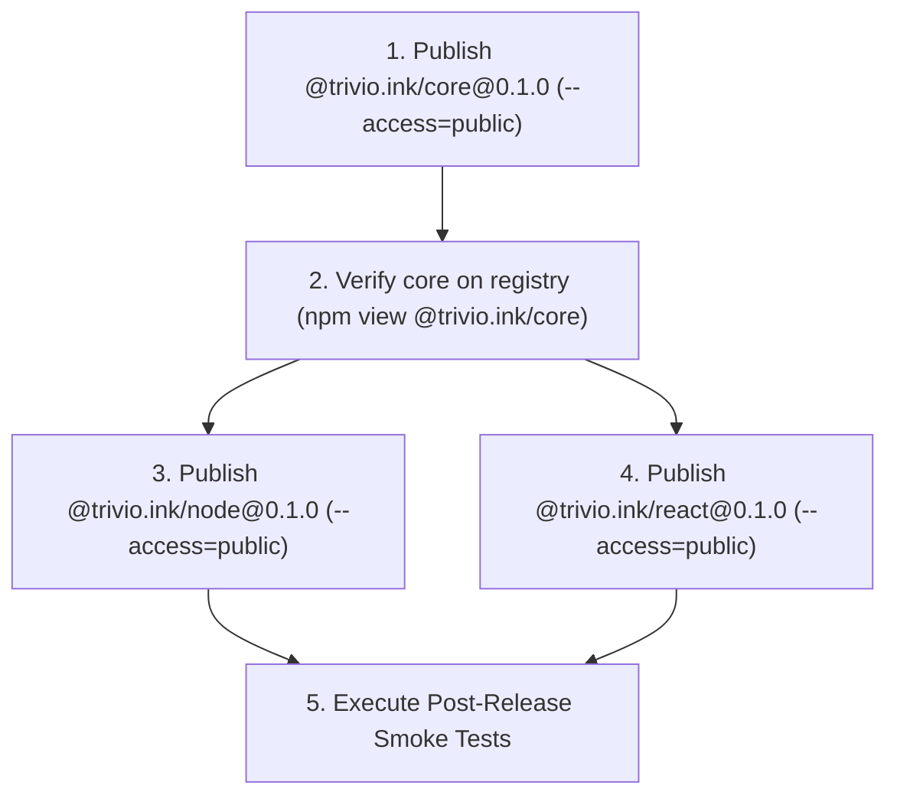

# Trivio Platform — npm Release Authorization & Governance Runbook

**Document Reference:** `REL-2026-001`  
**Public Brand:** `trivio.ink`  
**License:** Apache License, Version 2.0 (`Apache-2.0`), Copyright 2026 `trivio.ink`  
**Status:** **AUTHORIZATION PENDING (STAGE 3C-B2 COMPLETED — PUBLICATION BLOCKED)**  

---

## 1. Release Manifest (`v0.1.0`)

The proposed initial release comprises three scoped packages within the verified `@trivio.ink` npm organization:

| Package Name | Proposed Version | Target Registry | Access Level | License | Dependencies |
| :--- | :---: | :---: | :---: | :---: | :--- |
| **`@trivio.ink/core`** | `0.1.0` | `npmjs.org` | `public` | Apache-2.0 | Zero runtime dependencies |
| **`@trivio.ink/node`** | `0.1.0` | `npmjs.org` | `public` | Apache-2.0 | `@trivio.ink/core: ^0.1.0` |
| **`@trivio.ink/react`** | `0.1.0` | `npmjs.org` | `public` | Apache-2.0 | `@trivio.ink/core: ^0.1.0`, `react: >=18.0.0` (peer) |

### Tested Distribution Archive Artifacts

Tarballs generated and verified via `npm pack` (isolated consumer execution passed 100%):

| Tarball Filename | Archive Size | Unpacked Size | Total Files | Whitelisted Contents |
| :--- | :---: | :---: | :---: | :--- |
| `trivio.ink-core-0.1.0.tgz` | ~59.2 kB | ~271.7 kB | 92 | `dist/`, `README.md`, `LICENSE`, `NOTICE` |
| `trivio.ink-node-0.1.0.tgz` | ~15.5 kB | ~54.5 kB | 16 | `dist/`, `README.md`, `LICENSE`, `NOTICE` |
| `trivio.ink-react-0.1.0.tgz` | ~30.5 kB | ~131.9 kB | 40 | `dist/`, `README.md`, `LICENSE`, `NOTICE` |

*Security & Leakage Verification:* All packages strictly exclude `src/`, `tests/`, `.github/`, `tsconfig.json`, `.env`, and private files. Zero intellectual property leakage.

---

## 2. npm Registry & Scope Ownership Verification

### Verified Ownership Evidence
1. **Organization Scope:** The organization `trivio.ink` is registered on npmjs.com.
2. **Owner Administrative URL:** The project owner verified control via the direct settings portal:  
   `https://www.npmjs.com/settings/trivio.ink/packages`
3. **Public Registry Namespace Availability Check:**
   - `GET https://registry.npmjs.org/@trivio.ink/core` -> **`404 Not Found`**
   - `GET https://registry.npmjs.org/@trivio.ink/node` -> **`404 Not Found`**
   - `GET https://registry.npmjs.org/@trivio.ink/react` -> **`404 Not Found`**

*Conclusion:* The `@trivio.ink` organization is owned by the project maintainer. No previous versions, placeholder packages, or conflicting package names exist on npm. The namespace is completely clean and available.

---

## 3. Legal Release Identity & Corporate Status

- **Approved Intended Copyright Holder:** `trivio.ink` (Registered company, as confirmed by owner).
- **Approval Reference:** `LIC-2026-001`, Revision 2 (15 November 2026).
- **Open-Source Scope:** `@trivio.ink/core`, `@trivio.ink/node`, `@trivio.ink/react` under Apache-2.0.
- **Reserved Commercial Scope:** Trivio Cloud hosted backend (`apps/api`), Merchant Console (`apps/console`), reconciliation microservices, database schemas, and brand trademarks (`trivio.ink`).
- **Owner Action Required Prior to Enterprise Commercial Distribution:** Confirm exact registered legal entity name (e.g. `Trivio Technologies Inc.`, `Trivio Ltd`) and formalize contributor intellectual property assignments.

---

## 4. Controlled Publication Strategy & Dependency Order

Because `@trivio.ink/node` and `@trivio.ink/react` depend on `@trivio.ink/core`, publication **must** follow strict dependency order:



### Publication Bootstrap Method

Under npm registry rules, brand-new scoped packages must be created with explicit public visibility (`--access=public`). Newly configured OIDC Trusted Publishers also require an existing package on npm and must complete their first release within 48 hours.

**Bootstrap Execution (When Owner Authorizes Stage 3C-B3):**
1. Owner temporarily sets `"private": false` in each package manifest on `developer-branch`.
2. Owner executes authenticated release from terminal with 2FA:
   ```bash
   npm publish --workspace=@trivio.ink/core --access=public
   npm publish --workspace=@trivio.ink/node --access=public
   npm publish --workspace=@trivio.ink/react --access=public
   ```
3. Once packages exist on npm, GitHub Actions OIDC Trusted Publishing can be linked in each package's npm settings for future automated releases.

---

## 5. Owner Action Checklist

### Pre-Release Verification (Completed)
- [x] Merge Stage 3C-B1 PR #15 (`f922975`) into canonical `main`.
- [x] Verify Apache-2.0 LICENSE and NOTICE files in all three packages.
- [x] Verify corporate copyright headers across 34 source files.
- [x] Run full test suite: 192 / 192 Vitest tests passing.
- [x] Run release verification script: 65 / 65 checks passing.
- [x] Execute isolated npm tarball installation test (`npm run test:tarball` passing).
- [x] Verify npm organization `trivio.ink` settings URL.
- [x] Query npm registry and confirm zero name conflicts (404 on all 3 names).

### Owner Actions Required for Publication (Stage 3C-B3)
1. **Enable npm Account 2FA:** Ensure Two-Factor Authentication (security key or authenticator app) is enabled on your npmjs.com account.
2. **Review Organization Member Permissions:** Confirm your npm account has `Owner` or `Admin` role in the `trivio.ink` organization.
3. **Formal Release Decision:** Explicitly authorize the initial release of `v0.1.0` in the Stage 3C-B3 milestone.
4. **Execute or Authorize Release:** Remove `"private": true` and publish according to the runbook.

---

## 6. Post-Publication Verification & Smoke Testing

Immediately after initial publication, execute the automated registry verification script:

```bash
# 1. Verify public availability
npm view @trivio.ink/core version
npm view @trivio.ink/node version
npm view @trivio.ink/react version

# 2. Verify independent external install from live npm
npm install --no-save @trivio.ink/core@0.1.0 @trivio.ink/node@0.1.0 @trivio.ink/react@0.1.0
```

---

## 7. Emergency Rollback & Deprecation Policy

In accordance with official npm unpublishing policies:
- **Within 72 hours of publication:** If a catastrophic security vulnerability or unintended secret leak is identified, a newly published package version may be unpublished using `npm unpublish <package>@<version>`. Note that npm prohibits re-publishing the identical version string once unpublished.
- **After 72 hours:** Packages cannot be unpublished. If a critical defect is identified, the maintainer must immediately deprecate the affected release via:
  ```bash
  npm deprecate @trivio.ink/<package>@0.1.0 "Critical defect: update to 0.1.1 immediately."
  ```
- **Hotfix Release:** A patched version (`0.1.1`) will be built, tested, and released following the standard governance workflow.
