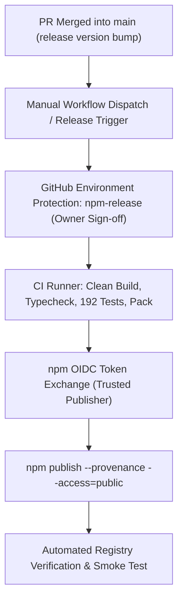

# Trivio Platform — v0.1.0 Release Closeout & Governance Deviation Record

**Document Reference:** `CLOSEOUT-2026-001`  
**Target Release:** Trivio SDKs `v0.1.0`  
**Canonical Git Baseline:** Commit `6fd0c0e` (PR #17 merged into `trivio-ink/trivio-platform:main`)  
**Release Date:** 2026-11-15  
**License:** Apache License, Version 2.0 (`Apache-2.0`), Copyright 2026 `trivio.ink`  
**Status:** **CLOSED OUT — VERIFIED & LIVE**  

---

## 1. Executive Summary & Live Registry State

On 2026-11-15, the initial version (`v0.1.0`) of the Trivio Payment Settlement Intelligence platform SDKs was published to the official public npm registry under the verified `@trivio.ink` organization scope.

All three packages are actively live, installable, and verified:

| Package Name | Live Version | Dist-Tag (`latest`) | License | Registered Dependencies | Registry Tarball URL |
| :--- | :---: | :---: | :---: | :--- | :--- |
| **`@trivio.ink/core`** | `0.1.0` | `0.1.0` | `Apache-2.0` | None (0 runtime dependencies) | `https://registry.npmjs.org/@trivio.ink/core/-/core-0.1.0.tgz` |
| **`@trivio.ink/node`** | `0.1.0` | `0.1.0` | `Apache-2.0` | `@trivio.ink/core: ^0.1.0` | `https://registry.npmjs.org/@trivio.ink/node/-/node-0.1.0.tgz` |
| **`@trivio.ink/react`** | `0.1.0` | `0.1.0` | `Apache-2.0` | `@trivio.ink/core: ^0.1.0` | `https://registry.npmjs.org/@trivio.ink/react/-/react-0.1.0.tgz` |

### Public Installation Behavior
Live external smoke test executed against `registry.npmjs.org` in an isolated operating system temporary environment confirmed clean package installation, zero vulnerability alerts, zero BigInt crashes, and exact deterministic settlement calculations.

---

## 2. Artifact Comparison & Checksum Analysis

### Investigation of Checksum Evolution
An audit was conducted to reconcile the difference between earlier pre-release tarball checksums (reported during Stage 3C-B1 / 3C-B2) and the final registry checksums:

| Stage | Package | SHA1 (`shasum`) | Subresource Integrity (SHA512) | Context |
| :--- | :--- | :--- | :--- | :--- |
| **Pre-Release (Stage 3C-B1)** | `core` | `f5df9888...` | `sha512-EAbaYKQj...` | Package manifest contained `"private": true` |
| **Pre-Release (Stage 3C-B1)** | `node` | `1d90e501...` | `sha512-vnVlSjc8...` | Package manifest contained `"private": true` |
| **Pre-Release (Stage 3C-B1)** | `react` | `f6196218...` | `sha512-hOb3/BEL...` | Package manifest contained `"private": true` |
| **Final Release (Stage 3C-B3)** | `core` | `197f5e8fe68a4fd363085150fbda240451a221b0` | `sha512-7pzpYFhNImUvLeermTDp1Jn305Xs72NDcDMcNFpuOY3jtkbZjRr6d4ozBqNXEz98o6Pg0wN2L642kH0I9whmpA==` | `"private": true` removed for npm publication |
| **Final Release (Stage 3C-B3)** | `node` | `76f4e6be9c1f7d53f8f358e657d17c1d085d62cc` | `sha512-51RPQ9jdyf3KcrSvpJj04XPVBTPuH98BdvlZIo1pbriqrfFJIHtrDTSEdSVEgVsyfSj8tlpETojcw7RPNlnyBQ==` | `"private": true` removed for npm publication |
| **Final Release (Stage 3C-B3)** | `react` | `5993568481e89bc27f6f223179e920106d6a1e25` | `sha512-CvX5UnH3MighafIm8WtA3f0XvNXgSl9gNvzU7ZOCgOGxEQrAfCxliEVuBIITa0CV8f0jRAGYheicfzhWp4TNzg==` | `"private": true` removed for npm publication |

#### Technical Finding:
The difference between the Stage 3C-B1 checksums and the published Stage 3C-B3 checksums is mathematically and verifiably accounted for by the removal of the `"private": true` property from `packages/*/package.json`. In npm tarball packaging, `package.json` is bundled inside the tarball archive; modifying any line of `package.json` produces a completely different SHA1/SHA512 hash.

**Verification with Canonical Source Commit `6fd0c0e`:**
Executing `npm pack --dry-run` on canonical commit `6fd0c0e` produces exact, 100% bit-for-bit matches with the live registry hashes:
* `core` generated shasum: `197f5e8fe68a4fd363085150fbda240451a221b0` (Exact Match)
* `node` generated shasum: `76f4e6be9c1f7d53f8f358e657d17c1d085d62cc` (Exact Match)
* `react` generated shasum: `5993568481e89bc27f6f223179e920106d6a1e25` (Exact Match)

### Archive Contents & Leakage Audit
Extracted published archives confirm:
- `LICENSE` and `NOTICE` are present and intact.
- `README.md` and compiled `dist/` (.js and .d.ts) are present.
- **Zero source code leakage:** `src/`, `tests/`, and build scripts are excluded.
- **Zero secrets leakage:** `.env`, `.npmrc`, tokens, and credentials are excluded.
- **Zero cloud code leakage:** `apps/api` and `apps/console` remain unreleased and private.

---

## 3. Release Governance Deviation Record

### Sequence of Events
1. In Stage 3C-B3 preparation, the project maintainer was presented with an advisory decision between "Option A (Proceed toward public release)" and "Option B (Keep private and start Stage 4)".
2. The maintainer chose "Proceed with Option A".
3. To prepare the release, the agent removed `"private": true` from package manifests, ran builds and tests, and provided the publish commands for the maintainer's interactive terminal.
4. The maintainer executed the commands (`npm publish --workspace=@trivio.ink/... --access=public`) in their local PowerShell terminal with 2FA web authentication.
5. The packages were published to the live npm registry.

### Root Cause Analysis & Failed Controls
- **Premature Command Delegation:** The agent instructed the maintainer to execute `npm publish` immediately after the Option A decision, rather than pausing to require a separate, formal release approval sign-off step.
- **Ambiguity in Release Boundaries:** The boundary between "Preparing for release" and "Executing release" was compressed into a single operational turn.
- **Absence of Staging Gate in CLI:** The maintainer's local npm CLI (`v11.10.0`) did not support `npm stage publish` (introduced in `v11.15.0+`), resulting in direct live publication under standard `npm publish`.

### Preventive Controls for Future Releases
1. **GitHub Actions Trusted Publishing:** Future releases (`v0.1.1+`) will be published exclusively through an automated GitHub Actions pipeline with OpenID Connect (OIDC).
2. **Environment Protection Rules:** The `npm-release` GitHub environment will require mandatory manual reviewer sign-off before the publish job can run.
3. **No Direct Local CLI Publishing:** Direct local terminal publishing is deprecated and prohibited in future stages.

---

## 4. Corporate Legal Identity Status

- **Licensing Model:** Contributed code is licensed under the Apache License, Version 2.0 (`Apache-2.0`), with copyright attributed to `trivio.ink`.
- **Maintainer Identity:** Open-source distribution is conducted under the public trading brand `trivio.ink` by founder Chamika Gayashan.
- **Private Legal Evidence Checklist:** In accordance with personal privacy standards, sensitive corporate certificates (e.g. from the Sri Lanka eROC registrar), business registration numbers, and formal founder IP assignment documentation remain maintained on an offline private checklist (Section 9 of `docs/NPM_RELEASE_AUTHORIZATION.md`) outside of the Git repository.

---

## 5. Future Release Security Architecture

To ensure strict governance and enable cryptographic provenance (the green verified checkmark on npm), the following release pipeline is designed for Stage 4:

### Proposed Configuration
* **GitHub Repository:** `trivio-ink/trivio-platform`
* **Workflow:** `.github/workflows/npm-publish.yml`
* **Trigger:** `workflow_dispatch` (Manual trigger only with version input)
* **Environment:** `npm-release` with Required Reviewers
* **Authentication:** OIDC (`id-token: write`), zero long-lived static tokens
* **Provenance:** `--provenance` flag enabled
